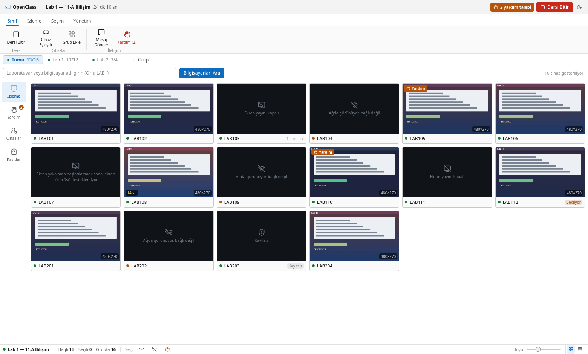
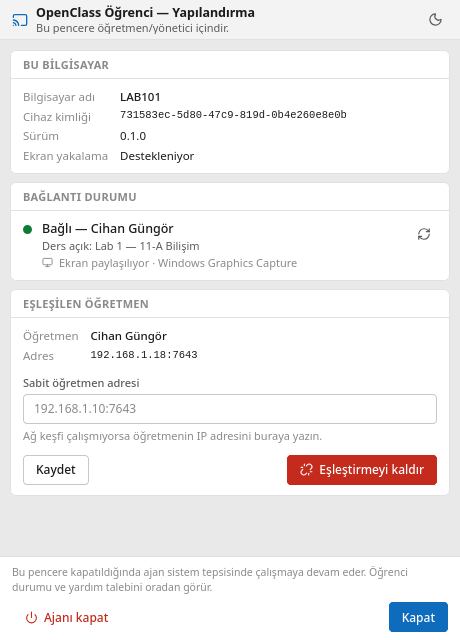

# OpenClass

**NetSupport School'a ücretsiz ve açık kaynak alternatif.** Okul bilgisayar
laboratuvarları için tasarlanmış sınıf yönetim yazılımı: öğretmen yerel ağdaki
öğrenci bilgisayarlarını bulur, güvenli biçimde eşleştirir ve ders oturumu
boyunca ekranlarını canlı izler.

> **Durum:** v0.1 geliştirme aşamasında. Aşağıdaki "Mevcut durum" bölümü
> neyin çalıştığını, neyin henüz çalışmadığını açıkça listeler.

## Neden?

Okullar sınıf yönetimi için pahalı, kapalı kaynak lisanslara bağımlı. OpenClass:

- **Tamamen ücretsiz ve açık kaynak** (GPL-3.0-or-later)
- **Sunucu gerektirmez** — öğretmen uygulaması bağlantı sunucusunu kendi içinde barındırır
- **İnternet gerektirmez** — yerel ağda çalışır, bulut hesabı veya abonelik yok
- **İki uygulamadan ibaret** — `OpenClass-Teacher.exe` ve `OpenClass-Student.exe`
- **Gizli izleme yok** — ekran paylaşımı öğrenciye her zaman görünür

## Mevcut durum

### Çalışanlar

| Özellik | Durum |
|---|---|
| Monorepo, iki ayrı derlenebilir uygulama | ✅ |
| Protokol katmanı (keşif / kimlik / kontrol) | ✅ birim testli |
| Cihaz eşleştirme (6 haneli kod + Ed25519 + parmak izi sabitleme) | ✅ birim testli |
| Hostname ön ek araması (`LAB1` → `LAB101`…) | ✅ birim testli |
| Değişen bölge (tile) aktarımı, anahtar kare, verim tavanı | ✅ birim testli |
| SQLite cihaz kaydı ve denetim günlüğü | ✅ birim testli |
| Öğretmen konsolu arayüzü (komut şeridi, grup çubuğu, durum çubuğu) | ✅ |
| Laboratuvar grupları + ad ön ekinden otomatik öneri | ✅ birim testli |
| Küçük resim ızgarası ↔ ayrıntılı tablo, sağ tık menüsü | ✅ |
| Öğrenci ajanı: sistem tepsisi + yalnızca yapılandırma penceresi | ✅ |
| Öğretmen ekranını öğrencilere yayınlama (tek kodlama, çok gönderim) | ✅ |
| İzinli uzaktan fare/klavye/scroll kontrolü | ✅ |
| UDP multicast yayın (şifreli, TLS yedekli) | ✅ |
| Pencereli / penceresiz yayın modu | ✅ |
| Öğrenci klavye/fare kilidi (zaman aşımlı) | ✅ |
| Öğrencilere dosya gönderme (özet doğrulamalı) | ✅ |
| Uzak dosya gezgini (yalnızca listeleme + indirme) | ✅ |
| Otomatik başlatma (Windows) | ✅ |
| Windows ekran yakalama (WGC + DXGI yedek) | ✅ gerçek Windows'ta doğrulandı |
| Linux'tan Windows'a cross-compile + NSIS kurulum paketi | ✅ |

### Henüz yapılmadı

- Sınav / anket / yoklama modülleri
- Linux'ta gerçek ekran yakalama (öğretmen ekranını yayınlamak Windows
  gerektirir; Linux'ta yalnızca test deseni yayınlanabilir)
- Çoklu monitör desteği

> **Dürüst durum raporu.** Gerçek Windows donanımında uçtan uca
> doğrulananlar: keşif, eşleştirme, TLS bağlantısı, ekran yakalama ve
> öğrenci ekranının öğretmen konsolunda görüntülenmesi.
>
> Kodu tamamlanmış ama **gerçek donanımda henüz doğrulanmamış** olanlar:
> uzaktan kontrol, ekran kilidi, dosya gönderme, uzak dosya gezgini ve
> multicast yayın. Bunlar derleniyor, birim testleri geçiyor ve tasarım
> gereği güvenli tarafta kalıyor; ancak `SendInput` ve `BlockInput` gibi
> işletim sistemi çağrıları ancak sahada kanıtlanır.
>
> v0.1, `docs/TEST-PLANI.md` içindeki senaryolar gerçek cihazlarda
> geçtiğinde tamamlanmış sayılacak.

## Ekran görüntüleri

| Öğretmen konsolu | Öğrenci yapılandırması |
|---|---|
|  |  |

Öğrenci normal kullanımda bu pencereyi görmez; ajan sistem tepsisinde çalışır.

Koyu tema ve ayrıntılı liste görünümü:
[`docs/ekran-goruntuleri/`](docs/ekran-goruntuleri/)

> Görüntüler arayüz geliştirme için kullanılan sahte veriyle alınmıştır;
> ekran içerikleri gerçek öğrenci masaüstleri değildir.

## Hızlı başlangıç

### Öğretmen

1. `OpenClass-Teacher.exe` kurun ve açın.
2. Windows Güvenlik Duvarı sorarsa **Özel ağlarda izin ver** seçin.
3. **Cihaz Eşleştir** → ekranda beliren 6 haneli kodu öğrenci bilgisayarına girin.
4. Eşleşen bilgisayarın ekranı **kendiliğinden** gelir; bir karta çift
   tıklayarak büyütebilirsiniz.
5. Arama kutusuna bilgisayar adı (`LAB1`) veya IP parçası (`192.168.1.`)
   yazarak süzebilirsiniz.

Ders oturumu konsol açıldığında kendiliğinden başlar. **Dersi Bitir** ile
tüm yayınları, kilitleri ve uzaktan kontrolü bir kerede durdurabilirsiniz.

### Öğrenci (kurulumu öğretmen/yönetici yapar)

1. `OpenClass-Student.exe` kurun. İlk açılışta yapılandırma penceresi gelir.
2. Listeden öğretmen konsolunu seçin (görünmüyorsa adresi elle girin).
3. Öğretmenin verdiği 6 haneli kodu girip **Eşleştir ve Bağlan**'a basın.
4. Pencereyi kapatın. Ajan artık sistem tepsisinde çalışır.

Öğrenci günlük kullanımda hiçbir ayar yapmaz. Tepsi simgesi bağlantı ve
ekran paylaşımı durumunu gösterir; sağ tık menüsünden yardım isteyebilir.

Ayrıntılı rehberler: [`docs/`](docs/)

## Mimari

```
                    UDP 7644/7645 (keşif)
   ┌─────────────────┐ ◄──────────────► ┌──────────────────┐
   │ OpenClass       │                  │ OpenClass        │
   │ Teacher         │ ◄══════════════► │ Student          │
   │ (konsol+sunucu) │  TCP 7643        │ (ajan)           │
   │                 │  TLS+WebSocket   │                  │
   │                 │  MessagePack     │                  │
   │                 │                  │                  │
   │                 │ ──────────────►  │                  │
   └─────────────────┘  UDP 7646        └──────────────────┘
                        multicast
                        (ChaCha20-Poly1305)
```

- **Keşif** şifresiz UDP'dir ve hiçbir yetki vermez.
- **Yetkilendirme** Ed25519 cihaz anahtarı + TLS parmak izi bağlamasıyla yapılır.
- **Ekran verisi** yalnızca değişen bölgeler hâlinde, ham JPEG olarak ikili WebSocket çerçevelerinde taşınır (Base64 yok).
- **Öğretmen ekranı yayını** UDP multicast ile gider: kare telden bir kez
  geçer. Yük ChaCha20-Poly1305 ile şifrelenir, oturum anahtarı yalnızca
  TLS kanalından dağıtılır. Paketi ulaşmayan öğrenciye TLS unicast yapılır.

Tasarım kararlarının gerekçeleri: [`docs/ARCHITECTURE.md`](docs/ARCHITECTURE.md) ·
arayüz yerleşimi: [`docs/ARAYUZ.md`](docs/ARAYUZ.md)

## Teknoloji

Tauri v2 · Rust · React 19 · TypeScript · Tailwind CSS v4 · Tokio · rustls ·
SQLite · Windows Graphics Capture

## Geliştirme

```bash
npm install
cargo test --workspace          # 138 birim testi
npm run typecheck
npm run dev:teacher             # arayüz geliştirme (Linux'ta da çalışır)

# Arayüzü Rust derlemeden, tarayıcıda sahte veriyle açmak için:
npm run dev --workspace @openclass/teacher   # http://127.0.0.1:1420
```

Windows paketleri (Linux'tan):

```bash
cd apps/teacher && cargo tauri build --runner cargo-xwin --target x86_64-pc-windows-msvc --bundles nsis
cd apps/student && cargo tauri build --runner cargo-xwin --target x86_64-pc-windows-msvc --bundles nsis
```

Ayrıntı: [`docs/GELISTIRME.md`](docs/GELISTIRME.md)

## Güvenlik

Açık bildirimi için [`SECURITY.md`](SECURITY.md). Özet:

- Bağlantılar TLS ile şifrelenir; sertifika eşleştirme anında sabitlenir.
- Cihazlar hostname ile değil, cihaza özgü Ed25519 anahtarıyla doğrulanır.
- Ekran görüntüleri diske **kaydedilmez**.
- Tepsi simgesi her zaman görünür ve paylaşım sırasında değişir; simgeyi
  gizleyen bir seçenek yoktur.
- Ders bittiğinde tüm yayınlar, kilitler ve uzaktan kontrol durur.
- Uzaktan kontrol ve ekran kilidi sırasında öğrencide kapatılamayan bir
  gösterge durur; kilidin zaman aşımı vardır ve Ctrl+Alt+Del engellenmez.
- Uzak dosya gezgini **yalnızca listeler ve indirir** — yazma ve silme
  protokolde tanımlı değildir; kapsam öğrenci tarafında kısıtlanır.
- Gizli erişim, keylogger, parola toplama veya güvenlik yazılımı atlatma
  mekanizması **yoktur ve eklenmeyecektir**.

## Katkı

[`CONTRIBUTING.md`](CONTRIBUTING.md)

## Lisans

[GPL-3.0-or-later](LICENSE). Tüm bağımlılıklar izin verici lisanslıdır
(MIT / Apache-2.0 / ISC / kamu malı) ve GPL-3.0 ile uyumludur.
